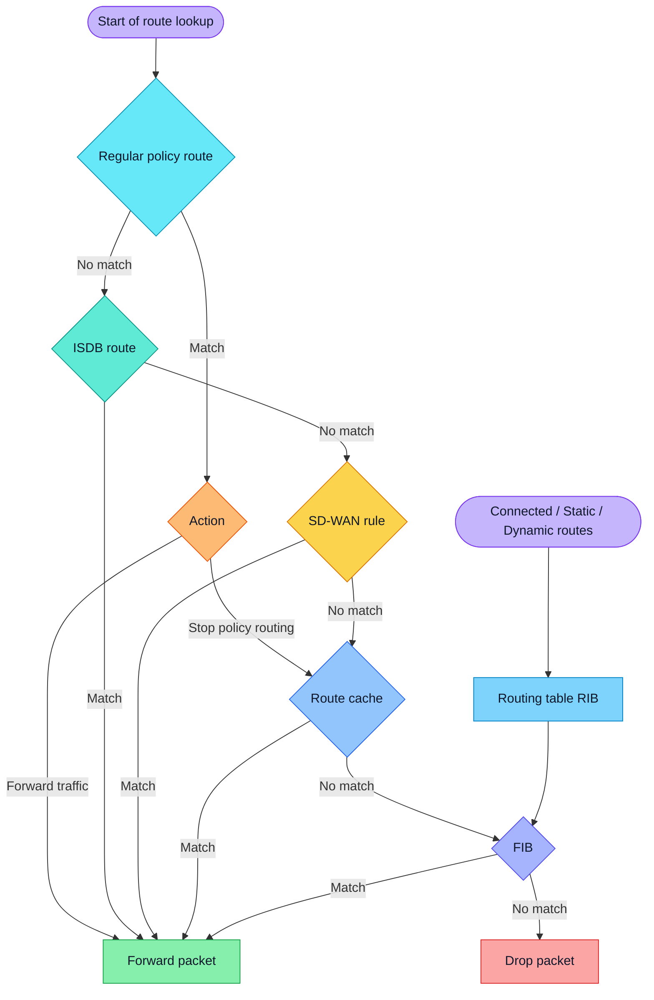

# Route Process

How a FortiGate decides where a packet goes. Based on the Fortinet KB article [Technical Tip: Routing in FortiGate (route-lookup-process)](https://community.fortinet.com/fortigate-3/technical-tip-routing-in-fortigate-route-lookup-process-96148), with extra notes from day-to-day troubleshooting.

Companion doc: [FortiOS-FortiGate.md](FortiOS-FortiGate.md) has every command used here, with examples.

## When the lookup happens

By default FortiGate does two route lookups per session:

1. On the first packet sent by the originator.
2. On the first reply packet coming back from the responder.

Every other packet follows the route already stored in the session. The only exception is a routing or config change that affects the session. FortiGate then marks the session as dirty, flushes its route information and runs the lookups again. That is how it revalidates routes, interfaces and gateways without checking each packet.

This is also why a "fixed" route sometimes seems to do nothing: the old session still holds the old path. Clear it (see [Sessions](FortiOS-FortiGate.md#sessions)) and test again.

## Flowchart



The image is an animated SVG. GitHub, GitLab, VS Code preview and most browsers play it. Each colored dot is one packet taking one possible path, and the dashed lines move in the direction the lookup runs.

| Dot | Scenario | Path |
|---|---|---|
| 🔵 Cyan | Policy route, action Forward | Start → Policy route → Action → Forward |
| 🟠 Orange | Policy route, action Stop policy routing | Start → Policy route → Action → Route cache → Forward |
| 🟢 Teal | ISDB route match | Start → Policy route (no match) → ISDB → Forward |
| 🟡 Amber | SD-WAN rule match | Start → Policy route → ISDB (no match) → SD-WAN → Forward |
| 🟣 Indigo | FIB match | Start → every policy table misses → Route cache misses → FIB → Forward |
| 🔴 Red | No route at all | Start → every table misses → Drop |

<details>
<summary>Static version (Mermaid), for viewers that don't show the SVG</summary>



</details>

---

## Legend

### 🟣 Start of route lookup

The entry point. It runs for the first packet of a new session and for the first reply. Before the route lookup itself, FortiGate also runs the reverse path check (RPF) on the first packet: there must be a route back to the source through the interface the packet came in on. If there isn't, the packet dies here and debug flow shows `reverse path check fail, drop`. Default RPF is loose (any active route back through that interface). `config system settings` → `set strict-src-check enable` makes it strict (the best route has to point back through that interface). You can turn RPF off per interface with `set src-check disable`, but treat that as a workaround for asymmetric routing, not a fix.

### Policy routing stage (dashed box)

The three tables in the dashed box all work like policy routes: they match on more than the destination and they are checked before the regular routing table. You can see all of them with:

```fortios
diagnose firewall proute list
```

Order matters. A regular policy route always wins over an ISDB route, and an ISDB route wins over an SD-WAN rule.

### 🔵 Regular policy route

What you build under Network > Policy Routes (`config router policy`). It can match on incoming interface, source and destination address, protocol, ports and ToS. Rules are checked top to bottom and the first match decides.

A match sends the packet to the **Action** diamond. A miss moves on to the ISDB route check. If no policy route exists at all, FortiGate skips straight to ISDB.

Typical use: send one subnet out a specific ISP, or force a server's traffic through a tunnel regardless of what the routing table says.

### 🟠 Action

Every policy route has one of two actions.

**Forward traffic** sends the packet out the policy route's interface and gateway right away. The routing table is never consulted.

**Stop policy routing** makes FortiGate leave the policy routing stage entirely and jump to the route cache and FIB. It skips ISDB and SD-WAN too. Use it as an exception: a policy route that sends 10.0.0.0/8 to the ISP, with a Stop rule above it for 10.50.0.0/16 so that subnet keeps using the normal routing table.

### 🟢 ISDB route

A static route whose destination is an Internet Service Database object instead of a subnet (`set internet-service <id>` under `config router static`). The ISDB is the FortiGuard-maintained database that maps IP ranges, ports and protocols to services such as Microsoft 365, Zoom or AWS.

A match forwards the packet immediately. A miss goes on to the SD-WAN rules. This is the way to send, for example, all Microsoft 365 traffic out one link without maintaining an address list by hand.

### 🟡 SD-WAN rule

SD-WAN service rules (`config system sdwan` → `config service`) are policy routes under the hood. They pick an SD-WAN member based on the rule's strategy: manual, best quality, lowest cost (SLA) or maximize bandwidth. A match forwards right away and stops the lookup.

Details that bite:

- Regular policy routes take precedence over SD-WAN rules. A forgotten policy route can silently override a perfectly good SD-WAN rule.
- A static route that points to an SD-WAN zone doesn't need a gateway; FortiGate takes it from the member config.
- On 6.4.0 and 6.2.3 onward, SD-WAN rules are skipped when the destination is a directly connected subnet.
- To see each rule and the member it picked: `diagnose sys sdwan service4` (7.4.4 and later) or `diagnose sys sdwan service` (older builds).

If no rule matches, traffic falls to the implicit rule, which means the regular routing table (and SD-WAN load balancing across members that have a route).

### 🔵 Route cache

A cache of recent lookups that saved a trip to the FIB. A hit forwards immediately; a miss goes to the FIB.

```fortios
diagnose ip rtcache list
```

Newer FortiOS builds run Linux kernel 3.6 or later, which dropped the route cache, and the command above no longer exists there. Check the kernel with `fnsysctl cat /proc/version`. On those builds this box simply doesn't exist and the lookup goes from the policy stage straight to the FIB.

### 🔷 Routing table (RIB)

The main routing table, fed by connected routes, static routes and dynamic protocols (BGP, OSPF, RIP). It is where FortiGate picks the best route per prefix:

- Longest prefix wins first. A /24 beats a /16 regardless of anything else.
- Between routes for the same prefix, the lowest administrative distance wins. Defaults: connected 0, static 10, eBGP 20, OSPF 110, iBGP 200.
- Static routes with the same distance all stay in the RIB; the lowest `priority` is the one used. Same distance and same priority means ECMP (load sharing).
- Routes whose interface is down, or whose link monitor failed, become inactive and leave the active table.

```fortios
get router info routing-table all
get router info routing-table database
```

The first shows the active routes. The second also lists inactive and standby ones, which is where you find the route you were sure existed.

### 🟪 Connected, static and dynamic routes

The sources that feed the RIB. Connected routes come from interface IPs, static routes from `config router static`, and dynamic routes from BGP, OSPF and friends. If a route never shows up in the RIB, check the source first: is the interface up, is the BGP neighbor Established, is the OSPF adjacency Full?

### 🟣 FIB (forwarding information base)

The kernel's copy of the best routes from the RIB, and the table actually used to forward packets. Also called kernel routes.

```fortios
get router info kernel
```

A match forwards the packet. A miss means FortiGate has nowhere to send it.

The RIB and the FIB should agree. When they don't (a route you see in `routing-table all` but not in `kernel`), suspect a stuck routing process or a route that was just withdrawn.

### 🟢 Forward packet

The packet leaves through the chosen interface and gateway, and that decision is saved in the session. From here, policy lookup, NAT and security profiles still apply. A route alone doesn't let traffic through; a firewall policy from the ingress interface to this egress interface still has to allow it. Check that with [Iprope lookup](FortiOS-FortiGate.md#iprope-lookup).

### 🔴 Drop packet

No table had a route, so the packet is unroutable and FortiGate drops it. In debug flow this shows up as a failed route lookup before any policy is checked. Common causes: a missing default route, a static route on an interface that is down, a link monitor that pulled the route, or a BGP session that dropped and took its prefixes with it.

---

## Command summary

| Stage | Command | Ex. |
|---|---|---|
| Policy routes, ISDB and SD-WAN | `diagnose firewall proute list` | `diagnose firewall proute list \| grep -i -A 10 port1` |
| SD-WAN rule status | `diagnose sys sdwan service4 [<id>]` | `diagnose sys sdwan service4 1` |
| Route cache (old kernels) | `diagnose ip rtcache list` | `diagnose ip rtcache list \| grep 10.11.100.` |
| Kernel version | `fnsysctl cat /proc/version` | `fnsysctl cat /proc/version` |
| Active RIB | `get router info routing-table all` | `get router info routing-table all \| grep 0.0.0.0/0` |
| RIB with inactive routes | `get router info routing-table database` | `get router info routing-table database \| grep -i inactive` |
| Route for one IP | `get router info routing-table details <ip>` | `get router info routing-table details 192.168.1.99` |
| FIB | `get router info kernel` | `get router info kernel \| grep 10.11.100.` |
| See the decision live | debug flow | see [Debug flow](FortiOS-FortiGate.md#debug-flow) |

## Related articles

- [Technical Tip: Multiple default routes where SD-WAN rules are not preferred](https://kb.fortinet.com/kb/documentLink.do?externalID=FD47747)
- [Troubleshooting Tip: Route cache is removed from FortiGates running new kernel version](https://community.fortinet.com/t5/FortiGate/Troubleshooting-Tip-Route-cache-is-removed-from-FortiGates/ta-p/265370)
- [Technical Tip: Creating a static route for Predefined Internet Services (ISDB)](https://community.fortinet.com/t5/FortiGate/Technical-Tip-Creating-a-static-route-for-Predefined-Internet/ta-p/198756)
